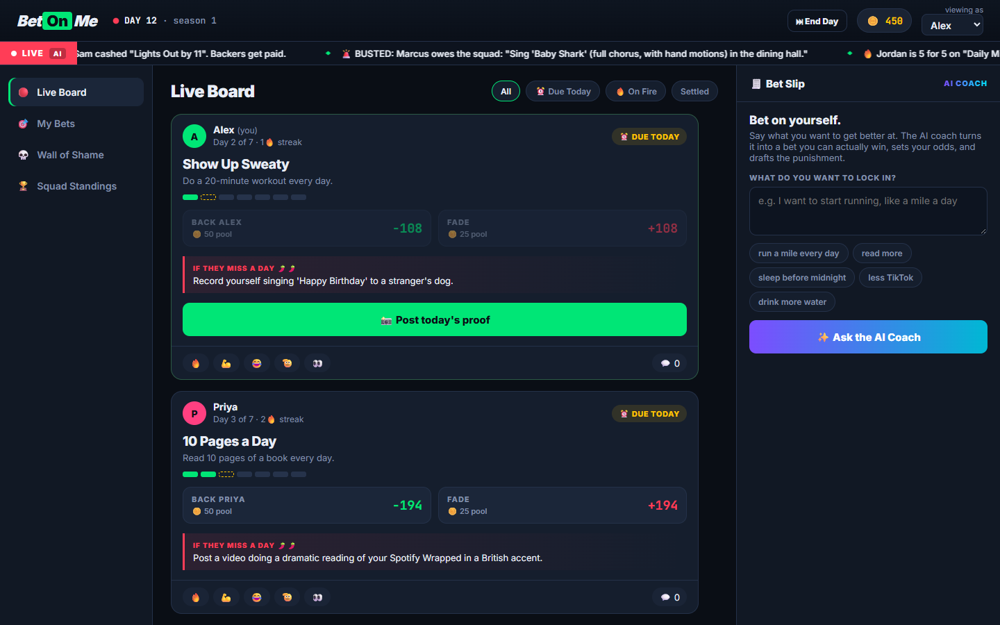

# 🎯 BetOnMe

**Bet on yourself. Your friends will collect.**

BetOnMe is a habit app that looks and feels like a sportsbook. You bet on yourself ("I'll run a mile every day for 14 days"). If you miss a day, you owe your friends the punishment you picked, and you have to record it and post it on the **Wall of Shame**. Your friends are the refs, the bettors, and the audience.



▶️ **Demo video:** [docs/demo.mp4](docs/demo.mp4)

## Features

- **AI Goal Coach**: describe a vague goal ("i want to get back into running but i always quit"). Claude turns it into a specific, provable daily bet, suggests a realistic length, sets **honest odds** (shown as a sportsbook line, e.g. `-138`), drafts 3 punishments from mild 🌶️ to spicy 🌶️🌶️🌶️, and gives a tip for winning.
- **AI Referee**: post a photo as daily proof, and Claude's vision model checks it against the bet's terms. If it rejects a legit photo, **any friend can overrule it**, so humans get the final word.
- **Back or Fade**: friends wager squad coins (not real money) on whether you'll make it. Payouts follow the AI's odds.
- **Live ticker**: an AI sportscaster comments on the board in real time: streaks, who's due today, who busted.
- **BUSTED**: miss a day and the AI writes a breaking-news headline. Your punishment is now owed.
- **Wall of Shame**: upload the punishment video. Friends react 😂🫡🔥 and comment.
- **Squad Standings**: coins and W-L records for the friend group.

## Run it

```bash
npm install
export ANTHROPIC_API_KEY=sk-ant-...   # optional, see below
npm start                              # http://localhost:3000
```

- Use the **"viewing as"** dropdown to switch between friends (it's a single-device demo, no auth).
- **⏭ End Day** is a demo time machine: it ends the day, busts anyone who didn't post proof, and pays out finished bets.
- Without an API key, the app runs in **offline mode** with heuristic stand-ins for each AI feature, so a demo never breaks. Set the key to get real Claude output.

## Tech

- **Backend:** Node + Express, JSON file store (`data/db.json`), Multer for photo/video uploads
- **Frontend:** vanilla JS + CSS, no build step
- **AI:** Anthropic SDK (`claude-opus-5-5`) with structured outputs (Zod schemas) for the coach, referee (vision), ticker commentary and bust headlines. See [`ai.js`](ai.js).
- **Demo tooling:** `npm run assets` generates placeholder media, `npm run record` drives a scripted Playwright walkthrough and encodes it with ffmpeg.

Coins are for bragging rights only. BetOnMe involves no real-money gambling.
